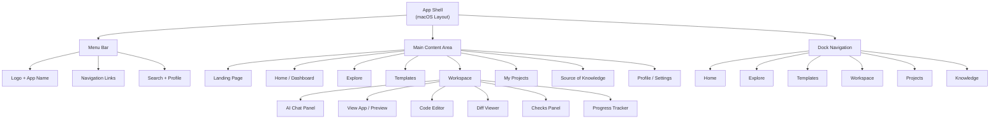
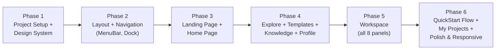

# F-FORUM — Kế hoạch triển khai giao diện macOS Liquid UI

> [!NOTE]
> **Đã cập nhật** sau khi phân tích Landing Page cũ tại [f-forum.vercel.app](https://f-forum.vercel.app/)

## Mô tả mục tiêu

Phát triển giao diện front-end hoàn chỉnh cho **F-FORUM** — AI Creation Platform (chuyển đổi từ diễn đàn học thuật sang nền tảng tạo website/app bằng AI). Giao diện kết hợp **phong cách macOS Liquid** với **brand identity hiện tại** của F-FORUM (Oriental Cyber-Academic, dark theme, vàng kim accent).

**Công nghệ**: React 18 + Tailwind CSS v3 + Framer Motion + React Router  
**Phạm vi**: Front-end UI/UX cho tất cả trang chính — không có backend thật, dùng mock data  
**Thư mục dự án**: `C:\Users\lebat\.gemini\antigravity\scratch\f-forum`

---

## Phân tích Landing Page cũ & Chiến lược kế thừa

Qua phân tích [f-forum.vercel.app](https://f-forum.vercel.app/), tôi đã xác định các yếu tố brand identity cần giữ:

| Yếu tố | Landing Page cũ | Áp dụng cho bản mới |
|---|---|---|
| **Bảng màu** | Dark (#07090E), Gold (#F59E0B, #EAB308) | ✅ Giữ nguyên — dark theme + gold accent |
| **Logo** | Chữ "F" trong vòng tròn vàng + "F-Forum" serif italic | ✅ Giữ nguyên styling |
| **Typography** | Serif headings (Cormorant Garamond), Sans body (Inter) | ✅ Giữ font đôi này |
| **Glassmorphism** | Đã có backdrop-blur, viền kim loại mảnh | ✅ Nâng cấp thành macOS-grade glass |
| **Hiệu ứng** | Cá Koi, hoa sen, bụi vàng, astrolabe | ⚠️ Chỉ giữ cho Landing Page |
| **Mockup thiết bị** | iPhone 16 Pro, MacBook Pro (nút đỏ/vàng/xanh) | ✅ Phù hợp hoàn hảo với macOS UI |
| **Ngôn ngữ** | Tiếng Việt hoàn toàn | ✅ Giữ tiếng Việt, UI labels tiếng Anh |
| **Nút CTA** | Bo tròn lớn, vàng kim (primary), hồng neon (special) | ✅ Áp dụng cho button system |

### Chiến lược kết hợp: **"Academic macOS" Design Language**

```
Landing Page cũ (Oriental Cyber-Academic)
              +
     macOS Liquid UI patterns
              =
   ┌─────────────────────────────┐
   │   ACADEMIC macOS FUSION     │
   │                             │
   │  • Dark glass surfaces      │
   │  • Gold accent highlights   │
   │  • macOS Dock + Window      │
   │  • Serif headings           │
   │  • Elegant animations       │
   │  • Oriental subtle details  │
   └─────────────────────────────┘
```

---

## User Review Required

> [!IMPORTANT]
> **Landing Page**: Tôi sẽ giữ thiết kế Landing Page cũ (chỉ nhúng/kết nối với app mới). Phần ứng dụng bên trong sẽ được xây mới hoàn toàn theo phong cách "Academic macOS". Bạn đồng ý cách tiếp cận này?

> [!IMPORTANT]
> **Dữ liệu mẫu**: Nội dung sẽ dùng **tiếng Việt** là chính (phù hợp brand hiện tại), UI labels dùng **tiếng Anh** (phù hợp ngữ cảnh AI coding platform). Bạn muốn điều chỉnh gì không?

---

## Open Questions

> [!IMPORTANT]
> **Vì sản phẩm đã chuyển đổi** từ "diễn đàn học thuật" sang "AI Creation Platform", tôi sẽ:
> - Giữ branding (logo, màu, typography) nhưng cập nhật nội dung/slogan
> - Slogan mới đề xuất: **"From Ideas to Real Projects"** (đã có trong tài liệu)
> - Tagline: **"Biến ý tưởng thành sản phẩm web — không cần biết code"**
>
> Bạn có slogan/tagline khác không?

> [!NOTE]
> **Logo F-FORUM**: Giữ nguyên logo chữ "F" vòng tròn vàng + "F-Forum" serif italic từ bản cũ. Tôi sẽ tái tạo bằng CSS/SVG.

---

## Kiến trúc tổng quan



---

## Proposed Changes

### 1. Project Setup & Configuration

Khởi tạo dự án React với Vite, cấu hình Tailwind CSS v4 và các dependencies cần thiết.

#### [NEW] `package.json`
```json
{
  "name": "f-forum",
  "private": true,
  "version": "1.0.0",
  "type": "module",
  "scripts": {
    "dev": "vite",
    "build": "vite build",
    "preview": "vite preview"
  },
  "dependencies": {
    "react": "^18.3.1",
    "react-dom": "^18.3.1",
    "react-router-dom": "^6.28.0",
    "framer-motion": "^11.11.0",
    "lucide-react": "^0.460.0",
    "@phosphor-icons/react": "^2.1.0"
  },
  "devDependencies": {
    "@vitejs/plugin-react": "^4.3.0",
    "autoprefixer": "^10.4.20",
    "postcss": "^8.4.49",
    "tailwindcss": "^3.4.15",
    "vite": "^6.0.0"
  }
}
```

#### [NEW] `tailwind.config.js`
Cấu hình theme mở rộng cho phong cách "Academic macOS":
- **Custom colors**: 
  - `ff-deep` (#07090E), `ff-surface` (#0B0F17), `ff-elevated` (#111827)
  - `ff-gold` (#EAB308), `ff-gold-light` (#FBBF24), `ff-gold-amber` (#F59E0B)
  - `ff-rose` (#F43F5E), `ff-jade` (#10B981), `ff-blue` (#3B82F6)
- Backdrop blur utilities mở rộng (blur-xs → blur-3xl)
- Border radius lớn macOS-style (12px, 16px, 20px, 24px)
- Box shadow: macOS window shadow + gold glow variants
- Animation keyframes: dock bounce, window open/close, gold pulse, fade-in-up
- **Font family**: 
  - Heading: `'Cormorant Garamond', 'Playfair Display', Georgia, serif`
  - Body: `'Inter', 'SF Pro Display', system-ui, sans-serif`

#### [NEW] `vite.config.js`
Cấu hình Vite với React plugin và path aliases (`@/` → `src/`).

---

### 2. Design System — "Academic macOS" Components

Xây dựng hệ thống component kết hợp macOS UI patterns với brand identity F-FORUM (dark, gold, serif headings).

#### [NEW] `src/styles/globals.css`

**Color System** — dựa trên Landing Page cũ + macOS patterns:
```css
:root {
  /* === F-FORUM Brand Colors (from existing site) === */
  --ff-bg-deep:       #07090E;    /* Nền chính đen xanh */
  --ff-bg-surface:    #0B0F17;    /* Surface tối */
  --ff-bg-elevated:   #111827;    /* Elevated surface */
  --ff-bg-glass:      rgba(17, 24, 39, 0.7);  /* Glass overlay */
  
  --ff-gold:          #EAB308;    /* Gold primary */
  --ff-gold-light:    #FBBF24;    /* Gold hover/highlight */
  --ff-gold-amber:    #F59E0B;    /* Gold warm */
  
  --ff-rose:          #F43F5E;    /* Hồng neon (special CTA) */
  --ff-jade:          #10B981;    /* Xanh ngọc (success) */
  --ff-blue:          #3B82F6;    /* macOS blue (links, focus) */
  
  --ff-text:          #F3F4F6;    /* Text primary trắng ấm */
  --ff-text-muted:    #9CA3AF;    /* Text secondary */
  --ff-border:        rgba(234, 179, 8, 0.15); /* Viền vàng mảnh */
  --ff-border-glass:  rgba(255, 255, 255, 0.08); /* Viền glass */

  /* === macOS Window Dots === */
  --macos-close:      #FF5F57;
  --macos-minimize:   #FEBC2E;
  --macos-maximize:   #28C840;
}

/* Light theme override */
[data-theme="light"] {
  --ff-bg-deep:       #F5F5F7;    /* macOS Sonoma light bg */
  --ff-bg-surface:    #FFFFFF;
  --ff-bg-elevated:   #FFFFFF;
  --ff-bg-glass:      rgba(255, 255, 255, 0.72);
  --ff-text:          #1D1D1F;
  --ff-text-muted:    #6E6E73;
  --ff-border:        rgba(0, 0, 0, 0.06);
  --ff-border-glass:  rgba(0, 0, 0, 0.1);
}
```

**Thêm**:
- Glassmorphism base classes (`.glass-panel`, `.glass-card`, `.glass-dock`)
- Custom scrollbar kiểu macOS (mảnh, tối)
- Typography: **Cormorant Garamond** (headings, brand) + **Inter** (body, UI)
- Hiệu ứng vibrancy: `backdrop-filter: blur(20px) saturate(180%)`
- Gold gradient utilities cho borders và text

#### [NEW] `src/components/macos/MenuBar.jsx`
**Menu Bar** cố định trên cùng (chiều cao 32px), nền glassmorphism tối + viền vàng mảnh:
```
┌─────────────────────────────────────────────────────────┐
│  Ⓕ F-Forum   Home  Explore  Templates  │  🔍  🔔  👤  │
└─────────────────────────────────────────────────────────┘
```
- Logo serif vàng bên trái (giữ nguyên branding)
- Navigation links giữa (highlight active = gold underline)
- Search spotlight (⌘K), notifications, avatar bên phải
- Nền: `var(--ff-bg-glass)` + `backdrop-blur(20px)`
- Viền dưới: gold subtle border
- Responsive: Thu gọn thành hamburger menu trên mobile (tham chiếu drawer menu cũ)

#### [NEW] `src/components/macos/Dock.jsx`
**Dock** cố định phía dưới, nền glassmorphism tối + viền vàng mờ, bo tròn lớn:
```
         ┌──────────────────────────────────────┐
         │  🏠  🧭  📐  💻  📁  📚  │  ⚙️  │
         └──────────────────────────────────────┘
```
- 6 icon chính + separator + settings
- **Nền**: `var(--ff-bg-glass)` + `backdrop-blur(24px)` + viền gold subtle
- **Magnification effect**: Icon phóng to khi hover (Framer Motion)
- **Active indicator**: Chấm vàng sáng dưới icon trang hiện tại
- **Tooltip**: Tên trang hiện khi hover (glass tooltip)
- **Bounce animation**: Khi click để chuyển trang
- Responsive: Trên mobile, Dock chuyển thành tab bar đơn giản ở dưới

#### [NEW] `src/components/macos/Window.jsx`
**Window container** kiểu cửa sổ macOS:
```
┌─── ● ● ● ──── Window Title ─────────────────┐
│                                               │
│                Content Area                   │
│                                               │
└───────────────────────────────────────────────┘
```
- Title bar với 3 nút đỏ/vàng/xanh (close/minimize/maximize)
- Drag handle (visual only)
- Shadow kiểu macOS window
- Bo tròn góc 12px
- Framer Motion: animation open/close (scale + fade)
- Các variant: `default`, `sidebar`, `floating`, `sheet`

#### [NEW] `src/components/macos/SpotlightSearch.jsx`
**Spotlight Search** dialog (⌘K) — glass dark + gold accent:
- Modal overlay với backdrop blur tối
- Ô search lớn ở giữa, viền vàng mảnh, placeholder "Tìm kiếm trang, template, tài nguyên..."
- Kết quả phân nhóm: Trang, Templates, Tài nguyên, Dự án
- Keyboard navigation (↑↓ Enter Esc)
- Framer Motion: slide down + fade in
- Mỗi kết quả: icon + tên + badge nhóm

#### [NEW] `src/components/macos/GlassCard.jsx`
Card component glassmorphism theo F-FORUM brand:
- **Dark mode (default)**: Background: `rgba(17, 24, 39, 0.7)`, viền `rgba(234, 179, 8, 0.15)`
- **Light mode**: Background: `rgba(255, 255, 255, 0.72)`, viền `rgba(0, 0, 0, 0.06)`
- Backdrop-filter: `blur(20px) saturate(180%)`
- Border-radius: 16px
- Hover: lift + gold glow effect (box-shadow vàng mờ)
- Variants: `default`, `elevated`, `interactive`, `featured` (viền vàng sáng hơn)

#### [NEW] `src/components/macos/Button.jsx`
Nút bấm kết hợp macOS + F-FORUM branding:
- Variants: `primary` (gold solid, bo tròn lớn), `special` (hồng neon), `secondary` (glass dark), `ghost` (text only), `danger`
- Sizes: `sm`, `md`, `lg`
- Loading state với spinner vàng
- Hover glow effect (gold shadow)
- Phong cách tham chiếu từ nút "Sảnh Thi CBT", "Đấu Trường 1vs1" của bản cũ

#### [NEW] `src/components/macos/Badge.jsx`, `Tag.jsx`, `Avatar.jsx`, `Tooltip.jsx`, `Modal.jsx`, `Dropdown.jsx`, `Tabs.jsx`, `Input.jsx`, `ProgressBar.jsx`
Các component UI cơ bản khác, tất cả theo phong cách macOS glass.

---

### 3. Layout & App Shell

#### [NEW] `src/layouts/AppLayout.jsx`
Layout chính cho toàn bộ ứng dụng (trừ Landing Page):
```
┌──────────── Menu Bar ────────────────────────┐
│                                               │
│                                               │
│            Main Content (Router)              │
│                                               │
│                                               │
│                                               │
├──────────── Dock ────────────────────────────┤
```
- Menu Bar cố định trên
- Dock cố định dưới
- Main content area có padding phù hợp
- Smooth page transitions (Framer Motion AnimatePresence)
- Responsive breakpoints: desktop (>1024px), tablet (768-1024px), mobile (<768px)

#### [NEW] `src/layouts/LandingLayout.jsx`
Layout riêng cho Landing Page — không có Menu Bar/Dock, full-screen sections.

---

### 4. Trang Landing Page

#### [NEW] `src/pages/Landing/LandingPage.jsx`

> [!IMPORTANT]
> **Chiến lược**: Thiết kế Landing Page **MỚI** phù hợp với định hướng AI Creation Platform, nhưng **GIỮ brand identity** từ bản cũ (dark theme, gold accent, serif headings, glassmorphism). Các yếu tố Oriental (cá Koi, hoa sen) sẽ được giảm bớt và thay bằng các yếu tố AI/tech phù hợp hơn.

**Section 1 — Hero** (Dark gradient bg + gold particles):
- Huy hiệu: "AI Creation Platform · Biến ý tưởng thành sản phẩm thật"
- Tiêu đề lớn (Cormorant Garamond, gold): **"From Ideas to Real Projects"**
- Subtitle: "F-FORUM giúp bạn tạo website và ứng dụng web bằng AI — không cần biết code"
- Prompt box demo (glassmorphism tối, viền vàng mảnh) với placeholder "Bạn muốn tạo gì?"
- CTA: "Bắt đầu tạo" (gold solid) + "Khám phá Templates" (glass)
- Background: Dark mesh gradient + floating macOS windows mờ (thay cho cá Koi)
- **Device Mockup**: MacBook Pro hiển thị Workspace preview (kế thừa ý tưởng mockup thiết bị từ bản cũ)

**Section 2 — How It Works**:
- 7 bước (Start → Clarify → Plan → Build → Review → Improve → Export)
- Timeline ngang, mỗi bước: icon vàng + mô tả ngắn
- Animation: steps reveal on scroll, gold line connecting steps

**Section 3 — Features Showcase**:
- 3 macOS Window cards: Quick Start, AI Workspace, Source of Knowledge
- Mỗi card có preview animation (typing effect, code highlight, search filter)
- Hover: lift + gold border glow

**Section 4 — Templates Preview**:
- 3 templates trong macOS browser window frame (nút đỏ/vàng/xanh)
- Carousel: Club Website, Portfolio, Quiz App
- Click: zoom animation vào template

**Section 5 — For Students & Clubs**:
- Split: text (trái) + illustration MacBook + iPhone mockup (phải)
- 3 cam kết (✅ icon xanh jade): Dễ bắt đầu, AI làm phần nặng, Xuất mã nguồn tự do
- Kế thừa phong cách 3 cam kết từ bản cũ ("Tập trung vào học thuật", etc.)

**Section 6 — CTA Footer**:
- "Sẵn sàng tạo sản phẩm đầu tiên?" + prompt box
- Brand footer: F-FORUM © 2026 + social links
- Giữ layout footer tương tự bản cũ (3 cột điều hướng)

---

### 5. Trang Home / Dashboard

#### [NEW] `src/pages/Home/HomePage.jsx`
Trang chủ sau khi đăng nhập — trung tâm điều hướng:

**Khu vực 1 — Prompt Box trung tâm**:
- Câu hỏi lớn: "What would you like to build?"
- Input field glassmorphism lớn, có icon ✨
- Gợi ý placeholder xoay: "A club website...", "A quiz app...", "A portfolio..."

**Khu vực 2 — Quick Start Grid**:
- 8 nút tác vụ trong macOS Window container
- Layout: 2 hàng × 4 cột (desktop), 2×2 (mobile)
- Mỗi nút: Icon + Title + Subtitle ngắn
- Các nút: Create Landing Page, Build Website, Create Portfolio, Create Club Website, Build Dashboard, Create Quiz App, Build Task Manager, Build Full-Stack App
- Hover: scale up + glow
- Click: Navigate đến Workspace với context

**Khu vực 3 — Featured Templates**:
- 3 template cards trong Window container
- Mỗi card: Screenshot preview + title + tags + "Use Template" button

**Khu vực 4 — Recent Projects** (nếu có):
- Danh sách 3-5 dự án gần đây
- Mỗi item: Tên, trạng thái (Draft/Building/Ready), ngày cập nhật
- "View All" link đến My Projects

---

### 6. Trang Explore

#### [NEW] `src/pages/Explore/ExplorePage.jsx`
Khám phá các loại sản phẩm có thể tạo:

- **Header**: "Explore what you can build" + search bar
- **Categories Grid**: 
  - Websites (Landing Page, Multi-page, Blog, E-commerce)
  - Web Apps (Dashboard, Quiz, Task Manager, Forms)
  - Design to Code
  - Commerce
- Mỗi category là một GlassCard lớn với icon, tên, số mẫu
- **Idea Gallery**: Các ý tưởng mẫu với screenshots trong macOS window frames
- **Trending**: Các loại sản phẩm phổ biến

---

### 7. Trang Templates

#### [NEW] `src/pages/Templates/TemplatesPage.jsx`
Thư viện template có sẵn:

- **Filter bar**: Category, Difficulty, Technology tags
- **Template Grid**: 
  - Mỗi template trong GlassCard:
    - Preview screenshot (trong macOS window frame)
    - Title + description
    - Tags (React, Tailwind, Beginner...)
    - "Preview" + "Use Template" buttons
  - 5 templates ban đầu: Club Website, Portfolio, Quiz App, Landing Page, Simple Dashboard
- **Template Detail Modal**:
  - Full preview trong macOS window
  - Feature list
  - Tech stack tags
  - "Start with this template" CTA

---

### 8. Trang Workspace — Trung tâm sản phẩm

Đây là trang phức tạp nhất, mô phỏng AI Workspace với các tab/panel.

#### [NEW] `src/pages/Workspace/WorkspacePage.jsx`
Layout Workspace chia thành các panel có thể resize:

```
┌────────────────────────────────────────────────────┐
│ Menu Bar                        Project: My Club   │
├──────────┬─────────────────────────────────────────┤
│          │  ┌─── View App ──────────────────────┐  │
│  AI Chat │  │                                   │  │
│  Panel   │  │   Live Preview (macOS browser)    │  │
│          │  │                                   │  │
│  ┌─────┐ │  └───────────────────────────────────┘  │
│  │ ... │ │  ┌─ Tabs: Code │ Diff │ Checks │ ... ┐ │
│  │ ... │ │  │                                   │  │
│  │ ... │ │  │   Tab content area                │  │
│  └─────┘ │  │                                   │  │
│  [input] │  └───────────────────────────────────┘  │
├──────────┴─────────────────────────────────────────┤
│ Dock                                                │
└────────────────────────────────────────────────────┘
```

#### [NEW] `src/pages/Workspace/panels/AIChatPanel.jsx`
Panel chat AI bên trái:
- Chat bubbles: User (phải, xanh) + AI (trái, glass)
- Typing indicator animation
- Input box với nút gửi + attach
- Suggested prompts khi chat trống
- Mock conversation data

#### [NEW] `src/pages/Workspace/panels/ViewAppPanel.jsx`
Live Preview trong macOS browser window:
- Address bar giả với URL localhost:3000
- Toggle: Desktop / Mobile preview (responsive frame)
- Full screen button
- Refresh button
- Hiển thị một static HTML preview mẫu (Club Website demo)
- Loading state animation

#### [NEW] `src/pages/Workspace/panels/CodePanel.jsx`
Code editor view (read-only, không cần Monaco):
- File tree sidebar nhỏ
- Syntax-highlighted code display (pre-formatted)
- Tab cho nhiều files
- Line numbers
- Phong cách editor tối (macOS Terminal-inspired)

#### [NEW] `src/pages/Workspace/panels/DiffPanel.jsx`
So sánh thay đổi:
- File list: added (xanh), modified (vàng), deleted (đỏ)
- Diff view: side-by-side hoặc unified
- Lines: green highlight (added), red highlight (removed)
- AI summary: "Changed hero section colors and added navigation menu"
- Mock diff data

#### [NEW] `src/pages/Workspace/panels/ChecksPanel.jsx`
Kết quả kiểm tra:
- Danh sách checks với trạng thái:
  - ✅ Build — "Project compiled successfully"
  - ✅ Preview — "Preview is running"
  - ⚠️ Responsive — "Some content overflows on small screens"
  - ❌ Links — "1 link is unreachable"
  - ⬜ Unit Tests — "Not configured"
  - ⬜ Secret Scan — "Not run"
- Expand để xem chi tiết

#### [NEW] `src/pages/Workspace/panels/ProgressPanel.jsx`
Theo dõi tiến trình AI:
- Timeline vertical:
  - ✅ Analyzed requirements
  - ✅ Created project structure
  - ✅ Built hero section
  - 🔄 Building navigation menu (spinner)
  - ⏳ Waiting: Add contact page
  - ⏳ Waiting: Run checks
- Animated progress bar tổng thể

#### [NEW] `src/pages/Workspace/panels/HistoryPanel.jsx`
Lịch sử phiên làm việc (mock):
- Timeline các sessions
- Mỗi entry: timestamp + summary + files changed

#### [NEW] `src/pages/Workspace/panels/ExportPanel.jsx`
Xuất dự án:
- "Download ZIP" button chính (MVP)
- "Export Docs" (README)
- "Push to GitHub" (disabled, "Coming soon")
- "Publish Website" (disabled, "Coming soon")
- File size estimate

---

### 9. Trang My Projects

#### [NEW] `src/pages/MyProjects/MyProjectsPage.jsx`
Quản lý dự án cá nhân:

- **Header**: "My Projects" + "New Project" button
- **Filter/Sort**: Status, Date, Name
- **Project Cards Grid**: Mỗi card trong GlassCard:
  - Preview thumbnail
  - Project name
  - Status badge (Draft / Building / Needs Review / Ready to Export / Archived)
  - Last updated date
  - Tags
  - "Open" button → navigate to Workspace
- **Empty State**: Illustration + "Create your first project" CTA
- Mock 3-5 dự án mẫu

---

### 10. Trang Source of Knowledge

#### [NEW] `src/pages/Knowledge/KnowledgePage.jsx`
Thư viện tài nguyên:

- **Search bar** trung tâm
- **Category Navigation** (tabs hoặc sidebar):
  - AI Tools, Prompts, GitHub Repositories, Skills & Rules, UI/UX Resources, Documentation, Learning Resources, Development Tools
- **Tag Filter System**: 
  - Multi-select tags (Category, Technology, Platform, Skill Level, Pricing, Resource Type, Use Case)
  - Active tags hiển thị dạng chips có thể xóa
- **Resource Cards Grid**: Mỗi resource card:
  - Name + description
  - Category icon + tags
  - Source link
  - Pricing badge (Free / Freemium / Paid)
  - Difficulty (Beginner / Intermediate / Advanced)
  - Verification status (✅ Verified / ⚠️ Not verified)
  - "Save" + "Use in Project" buttons
- **Resource Detail Modal** (Window component):
  - Full description
  - Compatibility info
  - Last checked date
  - Related resources
- Mock 15-20 tài nguyên đa dạng

---

### 11. Trang Profile / Settings

#### [NEW] `src/pages/Profile/ProfilePage.jsx`
Quản lý tài khoản:

- **Profile Section** (trong Window):
  - Avatar, name, bio
  - Edit profile
- **Usage Stats**:
  - Projects created
  - AI requests used
  - Storage used
- **Settings**:
  - Theme (Light / Dark / System)
  - Language
  - Notifications
  - Connected accounts (GitHub — coming soon)
  - Privacy settings
  - Data export / delete

---

### 12. Quick Start Flow

#### [NEW] `src/pages/QuickStart/QuickStartFlow.jsx`
Luồng hỏi đáp khi chọn Quick Start:

- **Step 1**: Chọn tên dự án
- **Step 2**: Mục đích chính
- **Step 3**: Người xem chính
- **Step 4**: Nội dung cần có (multi-select)
- **Step 5**: Phong cách (color picker + style options)
- **Step 6**: Xác nhận — Project Brief summary

Mỗi step là một full-screen card với animation chuyển bước (slide left/right).
"Skip" cho mỗi câu hỏi không bắt buộc.
Cuối cùng: "Start Building" → redirect to Workspace.

---

### 13. Responsive & Liquid Design Strategy

| Breakpoint | Layout |
|---|---|
| **Desktop** (≥1280px) | Menu Bar + full content + Dock ở dưới. Workspace: 3-panel layout |
| **Laptop** (1024-1279px) | Menu Bar + content (cards 3 cột) + Dock. Workspace: 2-panel (chat collapsible) |
| **Tablet** (768-1023px) | Menu Bar thu gọn + content (cards 2 cột) + Dock simplified. Workspace: single panel + tab switching |
| **Mobile** (< 768px) | Hamburger menu + content (cards 1 cột) + Bottom tab bar thay Dock. Workspace: single panel full-width |

Liquid design đảm bảo:
- Tất cả containers dùng `max-w-*` + `mx-auto` + `px-4/6/8`
- Cards dùng CSS Grid với `auto-fill` / `auto-fit` + `minmax()`
- Font sizes dùng `clamp()` cho fluid typography
- Spacing dùng relative units kết hợp với breakpoints
- Images dùng `object-cover` + aspect ratio containers

---

### 14. Animation & Transitions

| Element | Animation | Library |
|---|---|---|
| Page transitions | Fade + slide | Framer Motion `AnimatePresence` |
| Dock icons hover | Scale magnification (1 → 1.5) | Framer Motion `useMotionValue` |
| Dock icon click | Bounce effect | Framer Motion `spring` |
| Window open/close | Scale(0.95→1) + fade(0→1) | Framer Motion `variants` |
| Cards hover | TranslateY(-4px) + shadow expand | Tailwind transition + Framer |
| Spotlight open | SlideY(-20→0) + backdrop fade | Framer Motion |
| Quick Start steps | SlideX with direction | Framer Motion |
| Scroll reveal | FadeIn + slideUp on viewport enter | Framer Motion `useInView` |
| Chat messages | SlideUp + fade | Framer Motion |
| Progress items | Sequential stagger | Framer Motion `staggerChildren` |
| Theme toggle | Color transition 300ms | CSS transition on variables |

---

### 15. Cấu trúc thư mục dự án

```
f-forum/
├── index.html
├── package.json
├── vite.config.js
├── tailwind.config.js
├── postcss.config.js
├── public/
│   └── favicon.svg
├── src/
│   ├── main.jsx
│   ├── App.jsx
│   ├── styles/
│   │   └── globals.css
│   ├── components/
│   │   ├── macos/
│   │   │   ├── MenuBar.jsx
│   │   │   ├── Dock.jsx
│   │   │   ├── Window.jsx
│   │   │   ├── SpotlightSearch.jsx
│   │   │   ├── GlassCard.jsx
│   │   │   ├── Button.jsx
│   │   │   ├── Badge.jsx
│   │   │   ├── Tag.jsx
│   │   │   ├── Avatar.jsx
│   │   │   ├── Tooltip.jsx
│   │   │   ├── Modal.jsx
│   │   │   ├── Dropdown.jsx
│   │   │   ├── Tabs.jsx
│   │   │   ├── Input.jsx
│   │   │   └── ProgressBar.jsx
│   │   └── shared/
│   │       ├── Logo.jsx
│   │       ├── ThemeToggle.jsx
│   │       └── EmptyState.jsx
│   ├── layouts/
│   │   ├── AppLayout.jsx
│   │   └── LandingLayout.jsx
│   ├── pages/
│   │   ├── Landing/
│   │   │   └── LandingPage.jsx
│   │   ├── Home/
│   │   │   └── HomePage.jsx
│   │   ├── Explore/
│   │   │   └── ExplorePage.jsx
│   │   ├── Templates/
│   │   │   ├── TemplatesPage.jsx
│   │   │   └── TemplateDetailModal.jsx
│   │   ├── Workspace/
│   │   │   ├── WorkspacePage.jsx
│   │   │   └── panels/
│   │   │       ├── AIChatPanel.jsx
│   │   │       ├── ViewAppPanel.jsx
│   │   │       ├── CodePanel.jsx
│   │   │       ├── DiffPanel.jsx
│   │   │       ├── ChecksPanel.jsx
│   │   │       ├── ProgressPanel.jsx
│   │   │       ├── HistoryPanel.jsx
│   │   │       └── ExportPanel.jsx
│   │   ├── MyProjects/
│   │   │   └── MyProjectsPage.jsx
│   │   ├── Knowledge/
│   │   │   ├── KnowledgePage.jsx
│   │   │   └── ResourceDetailModal.jsx
│   │   ├── Profile/
│   │   │   └── ProfilePage.jsx
│   │   └── QuickStart/
│   │       └── QuickStartFlow.jsx
│   ├── data/
│   │   ├── mockTemplates.js
│   │   ├── mockProjects.js
│   │   ├── mockResources.js
│   │   ├── mockChat.js
│   │   ├── mockCode.js
│   │   └── quickStartOptions.js
│   ├── hooks/
│   │   ├── useTheme.js
│   │   └── useKeyboardShortcut.js
│   ├── context/
│   │   └── ThemeContext.jsx
│   └── utils/
│       └── constants.js
```

**Tổng cộng: ~45 files** bao gồm 15 macOS components, 11 pages, 8 workspace panels, 6 data files, và các utility/config files.

---

## Thứ tự triển khai

Tôi sẽ chia thành **6 giai đoạn** (phases), mỗi phase tạo ra một phần hoàn chỉnh có thể xem được:



| Phase | Files | Mô tả |
|---|---|---|
| **1** | ~12 | Config + globals + toàn bộ macOS components + mock data |
| **2** | ~5 | MenuBar, Dock, Layouts, App routing, SpotlightSearch |
| **3** | ~3 | Landing Page (6 sections) + Home Page (4 sections) |
| **4** | ~6 | Explore, Templates, Knowledge, Profile + detail modals |
| **5** | ~9 | WorkspacePage + 8 panels (Chat, Preview, Code, Diff, Checks, Progress, History, Export) |
| **6** | ~5 | QuickStart flow, My Projects, responsive tuning, final animations |

---

## Verification Plan

### Automated Tests
Dự án này chủ yếu là UI, không có logic backend phức tạp. Verification tập trung vào:

```bash
# Build test — đảm bảo compile thành công
npm run build

# Dev server — kiểm tra chạy được
npm run dev
```

### Manual Verification

Tôi sẽ kiểm tra sau mỗi phase:

1. **Build & Run**: `npm run build` không có lỗi
2. **Tất cả routes hoạt động**: Navigate giữa các trang không bị crash
3. **Responsive**: Kiểm tra ở các breakpoints (1280px, 1024px, 768px, 375px)
4. **Animations**: Dock magnification, page transitions, card hover effects
5. **Dark/Light theme**: Toggle và verify tất cả components render đúng
6. **Keyboard**: Spotlight search (⌘K / Ctrl+K) hoạt động
7. **Workspace**: Tất cả 8 panels render với mock data

> [!TIP]
> Sau khi hoàn thành, bạn có thể mở dev server (`npm run dev`) và test trực tiếp trên trình duyệt. Tôi khuyến nghị kiểm tra trên cả Chrome và Safari để đảm bảo glassmorphism effects render đúng.
